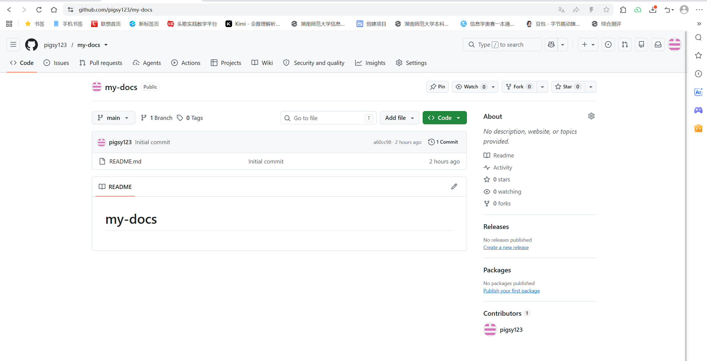
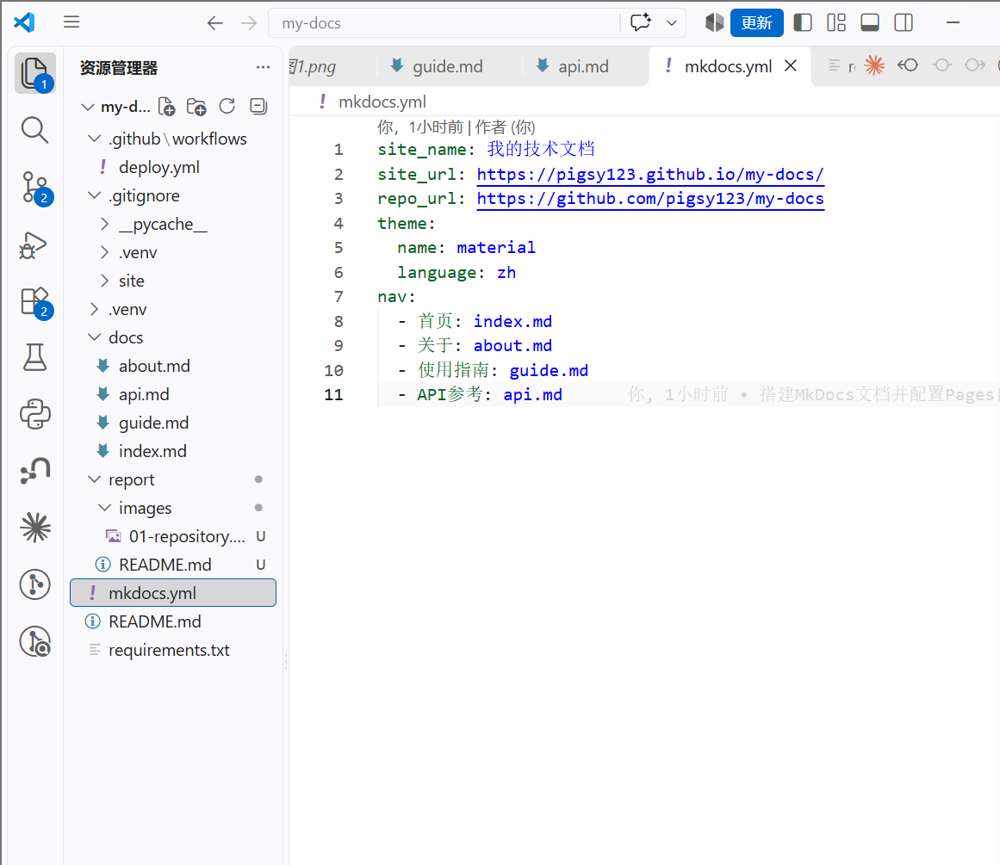
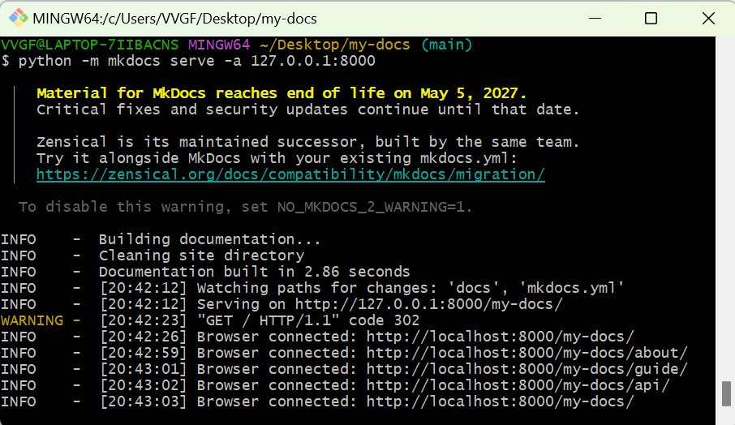
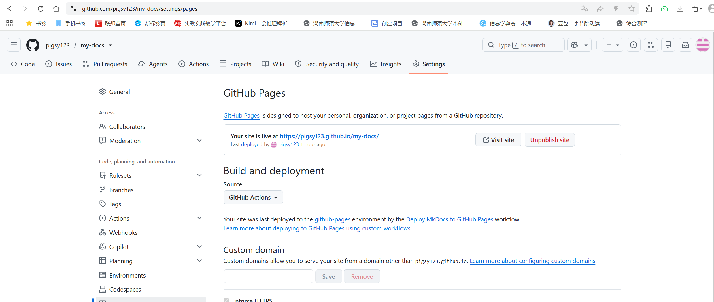
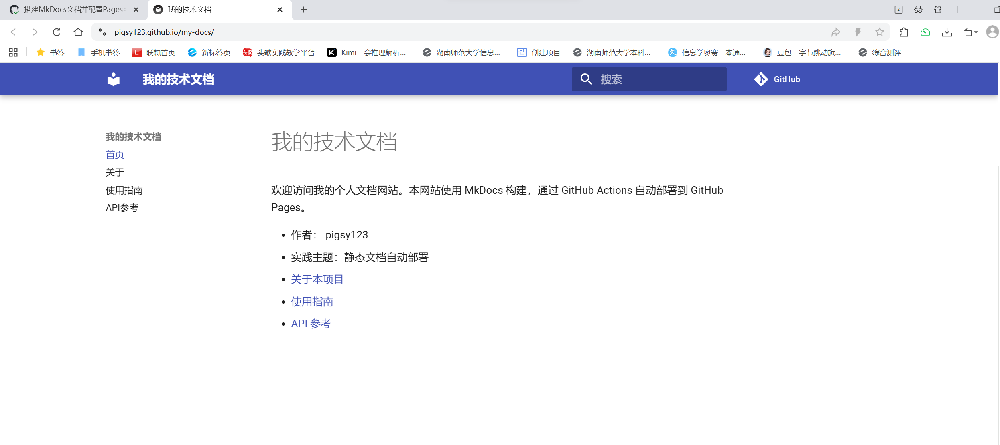
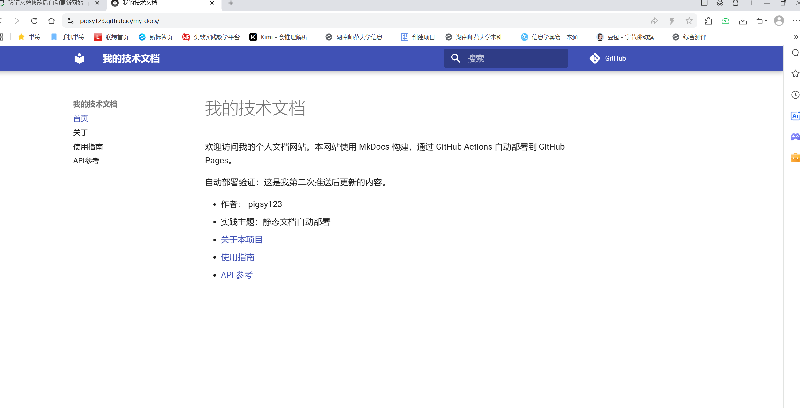
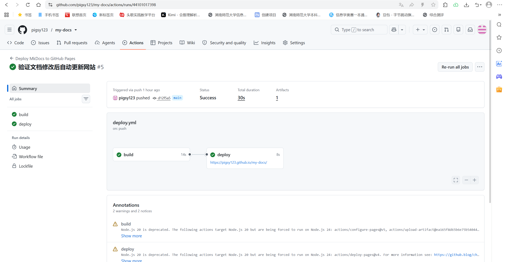

# 实践项目2：个人实验报告

## 1. 基本信息
- GitHub 登录名：pigsy123
- 个人仓库地址：https://github.com/pigsy123/my-docs.git
- 最终网站地址：https://pigsy123.github.io/my-docs/

## 2. 实践过程与关键截图
### 2.1 仓库创建
说明操作、结果和对应截图。
操作：先把要用的工具准备好：GitHub 账号、Git、Python3.12、VS Code，敲命令看一下版本，确认这些东西都装好了能用。
然后去 GitHub 新建一个公开仓库，名字叫 my-docs，默认分支是 main。把这个仓库下载（克隆）到自己电脑上，进到仓库文件夹里。
因为公开仓库才能免费开 Pages 网页；工作流写死只认 main 分支；克隆就是把网上仓库拿到本地改；设置名字邮箱是给提交记录打标记。
结果：本地生成 my-docs 文件夹，进入文件夹后执行 git branch --show-current 输出 main，仓库克隆成功，本地和远端仓库建立关联。

### 2.2 项目结构与 MkDocs 配置
操作：在根目录创建 mkdocs.yml、requirements.txt、.gitignore；docs 下放 4 篇 md 文档；.github/workflows 下放 deploy.yml。mkdocs.yml 管网站名字、导航、主题；requirements.txt 告诉工具要装哪些包；.gitignore 告诉 git 哪些文件不用上传。
docs/：存放所有 Markdown 源文件，是我们手写内容的地方；
nav：控制网页左侧导航栏，写在这里的顺序就是网站菜单顺序，路径是相对于 docs 文件夹；
site/：mkdocs build 自动生成的静态网页文件夹，不要手动改、不要提交到 git，每次构建会覆盖。
结果：目录结构完整，配置文件就绪，本地可以执行 mkdocs serve 预览网站。

### 2.3 本地构建或预览
操作：在项目根目录创建虚拟环境、激活环境，安装依赖，执行 mkdocs build --strict 构建，再执行 mkdocs serve 启动本地预览，浏览器访问 http://127.0.0.1:8000/
检查：导航能不能点、页面之间跳转是否正常、首页、关于页、使用指南页、API 页能不能正常显示。
目的：先在自己电脑上试好，没问题再上传到 GitHub，防止线上网页出错。
结果：构建没有报错，网页打开正常。

### 2.4 Pages 设置
操作：创建虚拟环境，装好依赖，先构建再打开本地预览网页。因为在推送到 GitHub 之前，先在本地验证文档和配置是否正确，提前发现 Markdown、YAML 语法错误，避免线上部署失败；虚拟环境用来隔离项目依赖，不影响电脑其他 Python 项目。
结果：本地构建成功，预览网站渲染正常，各项内容展示符合预期。

### 2.5 Actions 首次构建和部署
操作：先去 GitHub 仓库设置里，把 Pages 网页的发布方式改成由 GitHub Actions 自动处理；然后新建 deploy.yml 这个自动化脚本；最后把文档、配置文件提交推上去，虚拟环境和自动生成的 site 文件夹不要上传。因为脚本里写了 push 触发条件：只有改文档、改 mkdocs 配置的时候才跑流水线；只改实验报告不会重新发布网站，节省资源；
workflow_dispatch 支持手动点按钮运行，万一部署崩了，可以手动重试。
结果：推送后自动触发 Actions 流水线，依次执行构建、部署；流水线绿色成功后，Pages 网站就更新上线。

### 2.6 网站访问与四页导航检查
打开仓库的 Actions 页面，找到本次 Deploy MkDocs to GitHub Pages 运行记录，查看 build、deploy 两个任务状态。如果报错，点开红色步骤查看日志定位问题；部署成功后，从 Pages 页面或者部署记录拿到网站地址。
浏览器打开网站地址，依次访问首页、关于、使用指南、API 参考页面，逐项检查：侧边导航菜单、页面内跳转链接、API 页表格、JSON 代码块、文字渲染，确认没有链接失效、排版错乱。
四个页面均可正常打开，导航菜单、页面跳转链接、表格、代码块渲染正常，无乱码、无死链。

### 2.7 第二次推送与自动更新验证
- 对应提交链接：https://github.com/pigsy123/my-docs/actions/runs/44101017398
- 对应 Actions 运行链接：https://github.com/pigsy123/my-docs/commit/d12f5a5

## 3. 问题与解决
记录实际现象、关键日志、原因和解决操作。
在第一次推送文件到main是，requirements.txt没有保存
保存以后再操作一遍流程
如没有遇到错误，说明你核对过哪些日志和配置。

## 4. 原理理解
1. docs/ 和 site/ 各保存什么？为什么不用手工修改 site/？
docs/ 存放我们手写的 Markdown 源文档，是网站的原始内容；
site/ 是 mkdocs build 自动编译生成的静态 HTML、CSS、JS 文件，也就是最终给浏览器访问的网页。
每次执行构建都会完整覆盖 site 里的内容，手动改的内容在下一次构建时会被清空，所以不需要手工修改 site。
2. 本次工作流在什么情况下自动运行？
两种情况：
① 向 main 分支推送代码，并且改动的文件是下面这几类：docs/**、mkdocs.yml、requirements.txt、.github/workflows/deploy.yml，就自动触发；
② 手动在 Actions 页面点击运行（workflow_dispatch）。
单纯改 report、普通 README 不会自动跑。
3. build 与 deploy 两个任务有什么区别？
build：拉取源码、配置 Python、安装依赖、执行 mkdocs 构建，把 md 文档编译成网页，打包上传成制品；
deploy：必须等 build 成功之后才执行，把 build 产出的网页制品发布到 GitHub Pages，对外提供网站访问。
简单说：build 负责 “造网页”，deploy 负责 “把网页上线发布”。
4. 只修改 report/README.md 会触发部署吗？为什么？
不会触发。
工作流里写了 paths 过滤规则，只监听 docs/**、mkdocs.yml、requirements.txt、deploy.yml 的改动；report/README.md 不在监听路径列表里，推送之后不会启动流水线。
5. 本次方案为何无需创建 gh-pages 分支？
使用 GitHub 官方的 actions/upload-pages-artifact + actions/deploy-pages 这套新版 Pages 组件。它内部自动管理制品与发布，不需要我们手动维护 gh-pages 分支，工具会自动处理发布，不用自己新建、提交这个分支。